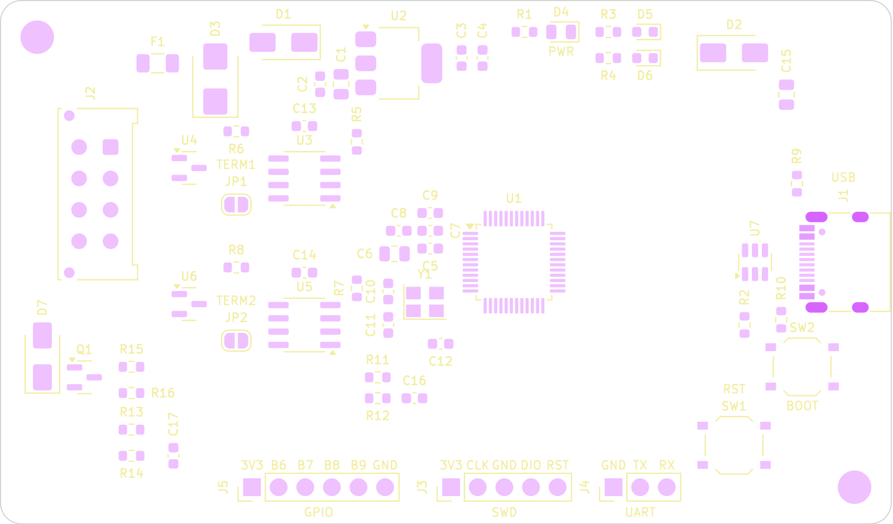

# canode: dual-CAN vehicle interface board

A small STM32G0B1 board with **two CAN channels**, USB-C, and a 12 V automotive input. Use it for sniffing, gatewaying and inline (MITM) modification of vehicle CAN traffic. Designed for JLCPCB Economic PCBA: all SMD parts are on top, and only the connectors are hand-soldered.



| | |
|---|---|
| MCU | STM32G0B1CBT6: 2× FDCAN, USB FS (crystal-less), 128 KB flash |
| CAN | 2× SN65HVD230 (3.3 V); standby by default; optional 120 Ω termination via solder jumper |
| Power | 12 V input (PTC, TVS, reverse-polarity diode) or USB, into a TPS7B69 40 V LDO |
| I/O | VBAT and AUX_IN voltage sense, AUX_OUT low-side switch, SWD, UART, 4 spare GPIO |
| Harness | Molex Micro-Fit 3.0, 2×4 |
| Board | 85 × 50 mm, 2-layer |

**Status:** rev A, not yet reviewed or ordered. See `hardware/README.md` for the design notes, ordering steps and review checklist. See `validation/README.md` for the validation plan.

## Quick start (macOS)
```bash
scripts/setup_mac.sh            # KiCad, ngspice, ARM GCC, OpenOCD, dfu-util, python venv
source .venv/bin/activate
make check                      # pinout check + ERC + DRC
make fab                        # JLC upload files -> build/fab/
```

## Repo map
- `hardware/`: KiCad project, fab outputs, docs, scripts
- `validation/`: automated checks and the step-by-step validation / bring-up plan
- `firmware/`: (not started) pin map and bring-up notes
- `tools/canlog/`: terminal CAN logger and byte-diff tool for STN-based OBD adapters (OBDLink MX+)
- `CLAUDE.md`: context and rules for Claude Code sessions
