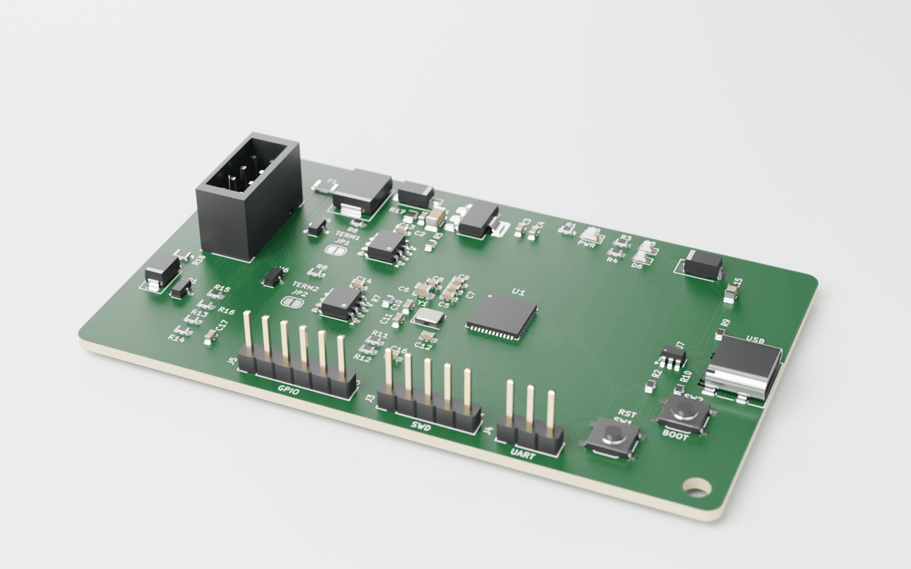
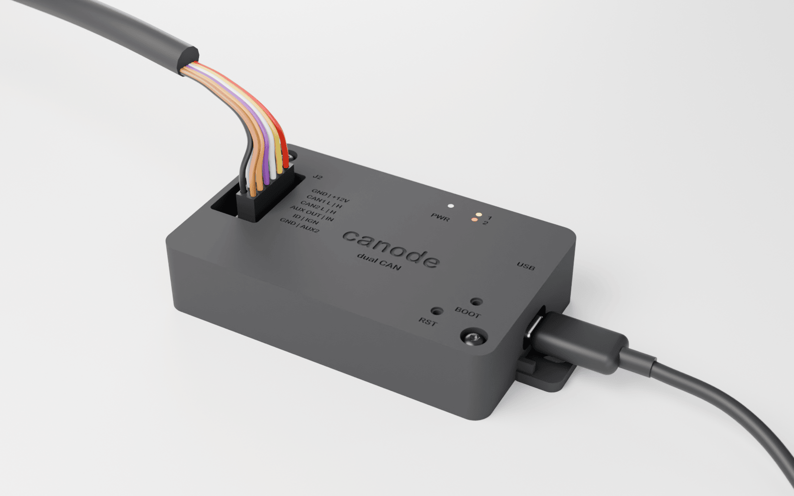
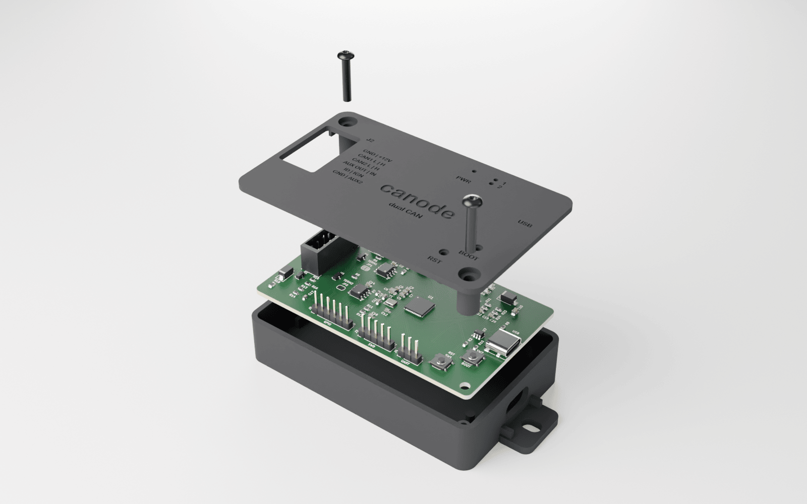
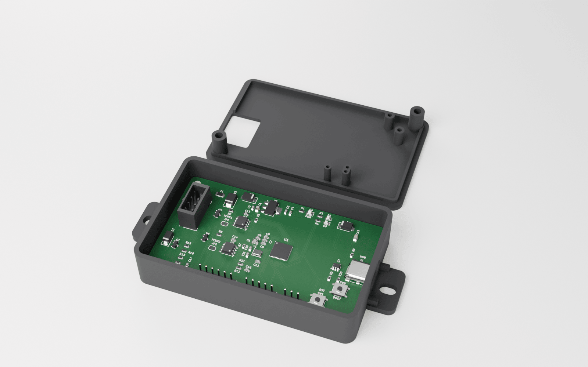
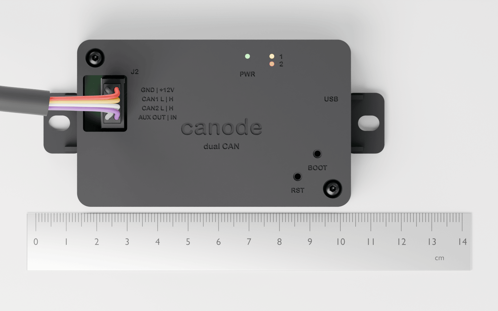
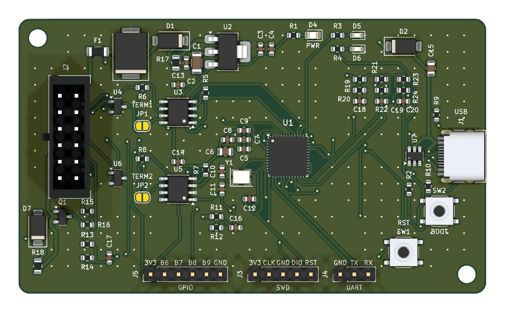
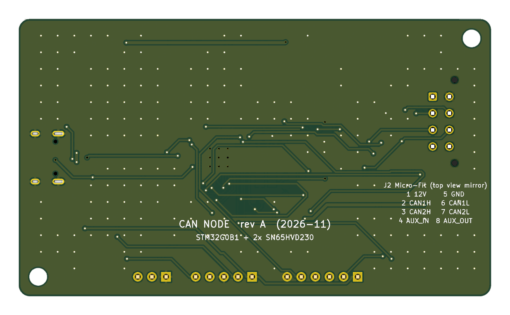
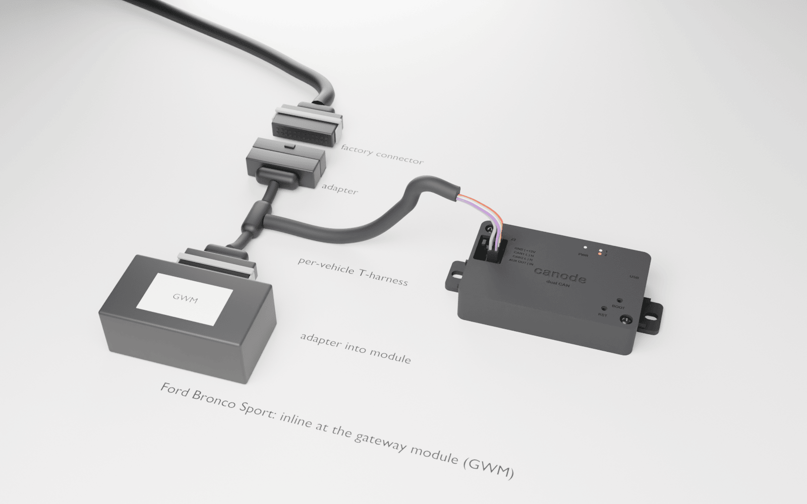
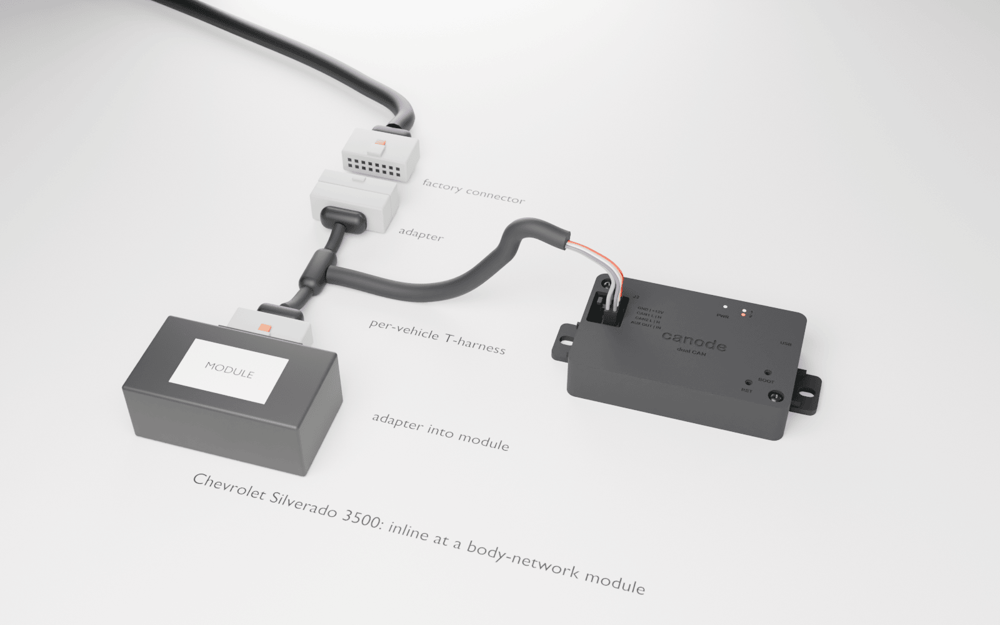
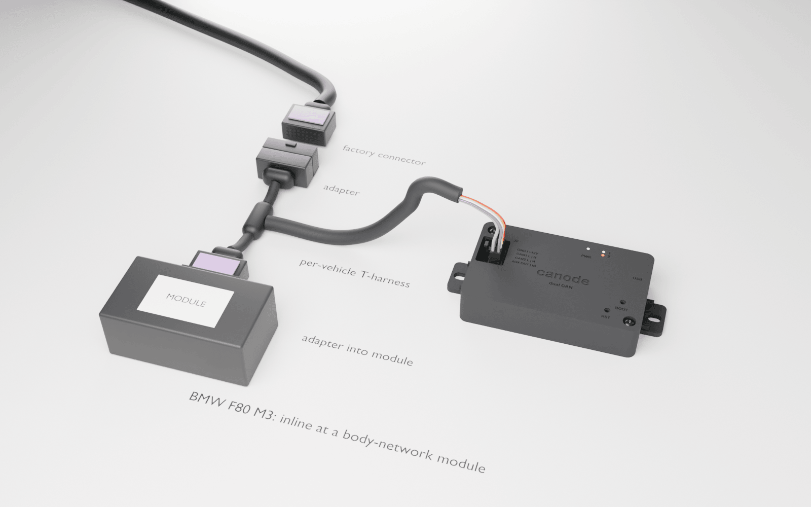

# canode: dual-CAN vehicle interface



A small STM32G0B1 board with **two CAN channels**, USB-C and a 12 V automotive input, for sniffing, gatewaying and inline (man-in-the-middle) modification of vehicle CAN traffic. CAN1 faces the car, CAN2 faces the module. A typical job: suppress auto start-stop or change a body-module behaviour without touching the factory wiring.

Target vehicles: 2021 Ford Bronco Sport (HS/MS-CAN), 2019 Chevrolet Silverado 3500 (GM Global A), possibly a 2016 BMW F80. All three use classic CAN, not CAN-FD.

> **Status: rev A, ready to order.** The design passes ERC and DRC, the footprints and parts have been checked against datasheets and LCSC stock, and the power input has been simulated against the 35 V suppressed load dump and ISO 7637-2 pulse 2a. Before ordering, confirm J2's pin order and U1's pin-1 mark in JLC's placement preview (see [Known limits](#known-limits)). Firmware builds and its logic is unit-tested, but nothing has run on hardware yet.

| | |
|---|---|
| MCU | STM32G0B1CEU6 (UFQFPN-48): Cortex-M0+ 64 MHz, 2× FDCAN, crystal-less USB FS, 512 KB flash |
| CAN | 2× SN65HVD230 (3.3 V, classic CAN to 1 Mbit/s); held in standby by hardware until firmware enables them; optional 120 Ω termination per channel (solder jumper) |
| Power | 12 V input (PTC, 1500 W TVS, reverse-polarity diode, RC filter) or USB, into a TPS7B69 40 V LDO; sleeps at about 1 mA when the buses go quiet |
| I/O | VBAT and AUX_IN voltage sense, AUX_OUT low-side switch, SWD, UART, 4 spare GPIO |
| Harness | Molex Micro-Fit 3.0, 2×4 |
| Board | 85 × 50 mm, 2 layers; every SMD part on top for JLCPCB Economic assembly |
| Enclosure | 90 × 55 × 20 mm MJF nylon, ordered from JLC3DP (no printer needed) |

## What it can do

Auto start-stop suppression is one rule set on a general-purpose tool. Every channel boots listen-only, and anything that transmits needs an explicit command (see [Safety model](#firmware)).

**With today's firmware** (built and unit-tested, not yet run on hardware):

| Capability | How |
|---|---|
| **Telemetry capture, both buses at once** | Streams every frame from the car side (CAN1) and the module side (CAN2), timestamped, in candump format over USB. A fully loaded 1 Mbit/s bus fits. `firmware/scripts/capture.py` saves a drive to a file that opens in SavvyCAN, can-utils or `tools/canlog`. |
| **Signal hunting** | Log while you press a button or change a setting, then diff the capture in `tools/canlog` to see which ID and byte moved. |
| **Silent sniffing** | Bus-monitoring mode sends no ACKs, and `rslisten high` also turns the transceiver's driver off in hardware. |
| **Inline filter / block / rewrite** | Per-direction rules between the car and one module: pass, drop, or rewrite the ID or any data nibble. Uses beyond start-stop include: forcing a setting the module would otherwise reset at key-on (drive mode, comfort settings); hiding a message a retrofit module objects to; remapping IDs so a module from another trim or year accepts the car's messages. |
| **Bench work on a module** | Put a module on the bench with canode as its "car": send frames by hand, watch its replies, and check error counters and bus-off state (`status`). |
| **Bus health** | Per-channel error counters, error-passive and bus-off flags, and lost-frame counts. Useful for chasing a flaky connector or a wrong bitrate. |

**Hardware is ready; the firmware still needs writing:**

| Capability | Uses |
|---|---|
| **Live decoded telemetry** | Decode known signals on the board (from a DBC) and stream values instead of raw frames: speed, RPM, gear, coolant and transmission temperature, boost, fuel level. That could feed a phone app or a custom gauge, e.g. trans temp while towing with the Silverado. |
| **OBD-II / UDS queries** | Ask ECUs for PIDs or read trouble codes, for data that isn't broadcast. It transmits, and it needs the tap point to be on the bus the ECU listens to. |
| **CAN-triggered output (AUX_OUT)** | The low-side switch drives a relay coil or LED, or pulls down a factory switch input. Examples: auxiliary lights with the high beams, a light bar, a reverse-camera or reverse-light trigger, a fan on high trans temp. |
| **Physical input (AUX_IN, 0–36 V)** | An added switch or an ignition/accessory feed selects a rule set or sends a message, e.g. a dash button that toggles a mode. |
| **Battery monitoring (VBAT sense)** | Log battery voltage, cranking dips and parked drain; cut AUX_OUT loads at low voltage. |
| **Permanent install** | Rules live in RAM today, and the gateway is off after every power-up. A fit-and-forget start-stop install needs rules saved to flash, plus an explicit opt-in to start the gateway at boot. |
| **Add-ons on J5** | The spare I2C/UART pins could take a Bluetooth or Wi-Fi module for a wireless console, an SD card or SPI flash for standalone logging, or a small display. |

**Out of scope:** CAN-FD frames (the transceivers are classic CAN, up to 1 Mbit/s), LIN, FlexRay and automotive Ethernet.

## What it looks like

| Closed, harness and USB connected | Exploded |
|---|---|
|  |  |
| **Lid off** | **Top view, cm scale** |
|  |  |

The harness plugs into J2 through the lid. USB-C, the three status LEDs and the RESET/BOOT poke-holes are reachable with the lid on. The debug headers and termination jumpers are inside, two screws away. Mount it with the screw/zip-tie ears or VHB tape. Design, ordering and assembly: [`hardware/enclosure/`](hardware/enclosure/README.md).

<details><summary>Board top and bottom</summary>



</details>

Regenerate every image with `make renders` (KiCad 10, Blender, uv; about 10 minutes).

## In the car: one board, a harness per vehicle

The board, enclosure and J2 connector are the same for every vehicle. Only the T-harness changes. It plugs in between a module and its factory connector, so nothing in the car is cut or spliced, and unplugging it puts the car back to stock.

| Ford Bronco Sport (gateway module) | Chevrolet Silverado 3500 |
|---|---|
|  |  |
| **BMW F80 M3** | |
|  | |

The housings in these renders are **representative**. Pin count, colour and lock style suggest each connector family, but they are not dimensioned copies of the OEM parts. Each real harness is built once the tap point (module and pins) has been confirmed on the car.

| T-harness wire | Goes to |
|---|---|
| Every pin except the CAN pair | straight through, factory connector ↔ module |
| CAN H/L from the factory connector (car side) | J2 pin 2 CAN1_H, pin 6 CAN1_L |
| CAN H/L into the module | J2 pin 3 CAN2_H, pin 7 CAN2_L |
| The module's battery feed (or a fused tap) | J2 pin 1 +12 V |
| The module's ground | J2 pin 5 GND |
| Optional: ignition or accessory feed | J2 pin 4 AUX_IN |

Notes:
- **Ford Bronco Sport:** plug-in start-stop eliminators for this vehicle sit inline between the factory harness and the gateway module behind the OBD port under the steering column ([example install](https://www.4dtech.com/ford-bronco-sport-21-22-start-stop-eliminator)). That is a natural canode tap point too.
- **Silverado and F80:** the common eliminators for these plug in behind the start-stop *switch*, which works at the button, not on CAN. For canode, the module to sit in front of is still to be picked.
- **Termination:** cutting a bus into two segments can leave one of them unterminated, for example when the module was an end node. Measure each segment (about 60 Ω is correct) and bridge JP1/JP2 only where a segment needs it.

## Harness (J2, Molex Micro-Fit 3.0 2×4)

| Pin | Signal | Pin | Signal |
|---|---|---|---|
| 1 | +12 V (battery or switched) | 5 | GND |
| 2 | CAN1_H | 6 | CAN1_L |
| 3 | CAN2_H | 7 | CAN2_L |
| 4 | AUX_IN (0–36 V sense) | 8 | AUX_OUT (low-side switch) |

Each H/L pair sits on adjacent pins across the two rows, so twisted pairs land cleanly. The pinout is also on the board's back silkscreen and engraved on the enclosure.

## Quick start (macOS)

```bash
scripts/setup_mac.sh            # KiCad 10, ngspice, ARM GCC, CMake, OpenOCD, dfu-util, Blender, Python venv
source .venv/bin/activate
make check                      # pinout check + ERC + DRC + firmware and tool unit tests
make fab                        # JLC upload files -> build/fab/
make firmware                   # canode + NUCLEO-G0B1RE images -> firmware/build/
make sim                        # ngspice power-input simulations
make renders                    # board + enclosure renders
```

Ordering steps are in [`hardware/README.md`](hardware/README.md#ordering-at-jlcpcb).

## Validation

The full plan, with pass criteria, is in [`validation/README.md`](validation/README.md); dated results are in [`validation/reports/`](validation/reports/).

| Check | Result |
|---|---|
| Netlist vs design table | ✅ 61 parts, 45 nets, 0 mismatches |
| MCU pinout vs ST's pin data (UFQFPN-48) | ✅ 29/29 incl. exposed pad on GND |
| Schematic ERC | ✅ 0 errors |
| DRC + schematic parity | ✅ 0 errors, parity clean |
| Footprint ↔ datasheet pinout | ✅ all match; J2's physical pin order still to confirm against the Molex drawing |
| Reference-design comparison | ✅ crystal load caps corrected (30 → 20 pF) |
| LCSC stock | ✅ out-of-stock MCU, TVS and LED replaced |
| Analog simulation | ✅ 35 V suppressed load dump, ISO 7637-2 pulse 2a, reverse battery, crank (after the [protection update](validation/reports/2026-11-09_protection.md)) |

## Firmware

Bare-metal C, CMake and `arm-none-eabi-gcc`, with ST's HAL for clocks/GPIO/FDCAN and TinyUSB for the USB virtual serial port. It builds for canode and for a **NUCLEO-G0B1RE** dev board, so you can start testing before the PCB arrives. Shell commands, flashing and the safety model are in [`firmware/README.md`](firmware/README.md).

**Safety model.** Both channels boot in FDCAN bus-monitoring mode (no ACKs, no transmit), with the transceivers held in standby until each controller is configured. Transmitting (normal mode, the gateway, sending a frame) requires an explicit shell command for one named channel, and nothing re-enables it automatically: not a bus-off recovery, a reboot, or a self-test.

## Known limits

1. **Load dump.** The input is built for the 35 V *suppressed* load dump that modern alternators produce: the SMCJ33A TVS doesn't conduct, and a 10 Ω + 10 µF filter keeps fast spikes under 30 V at the LDO. The board is **not** rated for an *unsuppressed* load dump (87 V). Details: [`validation/reports/2026-11-09_protection.md`](validation/reports/2026-11-09_protection.md).
2. **Quiescent current on an always-hot feed** is about 9 mA while the MCU is awake. The firmware now sleeps (STM32 Stop 1) after 60 s of bus silence and wakes on CAN1, CAN2 or a UART key. The estimated sleep draw is ~0.9 mA, plus ~0.1–0.17 mA for the always-on power LED (R1 is now 4.7 kΩ), so about 1 mA in total. A running gateway sleeps too and resumes on wake; while asleep, the car and module sides are disconnected, and the frame(s) that wake it aren't forwarded. Sleep is untested on hardware. Details: [`firmware/README.md`](firmware/README.md#sleep-stop-1).
3. **Unverified before ordering:** J2's physical pin order against the Molex 43045 drawing, and U1's pin-1 mark in JLC's placement preview (the package changed to QFN).

## Repo map

| Path | What |
|---|---|
| `hardware/kicad/` | KiCad 10 project: **source of truth** |
| `hardware/fab/` | JLC upload files for rev A (regenerate with `make fab`) |
| `hardware/docs/` | Schematic PDF and renders |
| `hardware/enclosure/` | Parametric enclosure (build123d), STEP files, render pipeline |
| `hardware/3dmodels/` | Stand-in 3D models for parts KiCad's library lacks |
| `hardware/generator/` | One-shot scripts that created rev A (don't re-run) |
| `firmware/` | STM32G0B1 firmware + host unit tests |
| `validation/` | Pin check, ngspice simulations, validation plan and reports |
| `tools/canlog/` | Terminal CAN logger and byte-diff tool for STN adapters (OBDLink MX+) |
| `CLAUDE.md` | Context and rules for Claude Code sessions |
