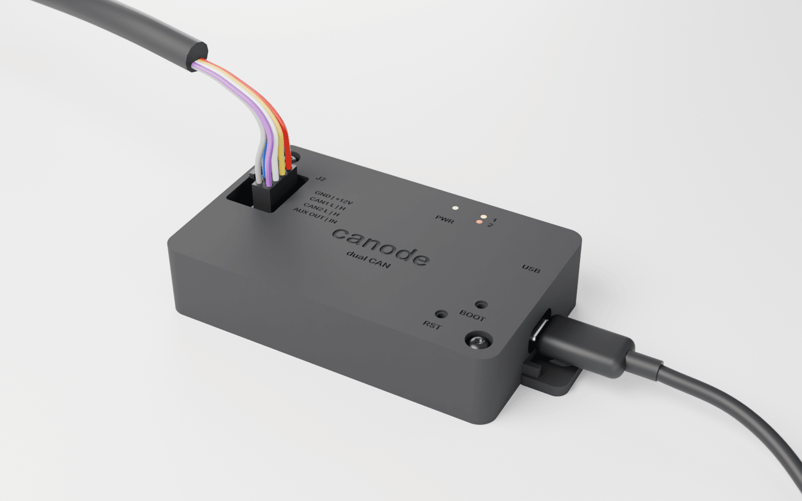

# canode enclosure, rev A

A two-part enclosure (base and lid), 3D-printed by JLC3DP in **MJF nylon (PA12)**. It is parametric, generated from the board's own dimensions with [build123d](https://github.com/gumyr/build123d), and the script checks for collisions against the populated KiCad board before writing files.



| | |
|---|---|
| Outer size | **90 × 55 × 20 mm** (108 mm long including the mounting ears) |
| Material | MJF PA12, black (JLC3DP "PA12S-HP", or PA12-HP grey) |
| Parts | `out/canode_enclosure_base.step`, `out/canode_enclosure_lid.step` (committed); `.stl` versions are written next to them when you regenerate (gitignored, they're 3–4 MB each) |
| Hardware | 2 × M3 × 16 button-head screws (ISO 7380), 2 × M3 heat-set inserts (4 mm long, for a 4.0 mm hole) |
| Mounting | Two slotted ears (M4 / #8 screw, or zip-ties up to 4.8 mm wide), or VHB tape on the flat bottom |

## Design choices

- **Why MJF nylon, not SLA resin or a stock box.** The unit lives under a dash or behind a panel. Car interiors reach 70–90 °C in sun, and standard SLA resins soften around 50–60 °C. JLC lists MJF PA12 at a 175 °C heat-deflection temperature. It is tough rather than brittle, needs no supports, and its ±0.3 mm tolerance is fine for this. An off-the-shelf box (e.g. Hammond 1551) would need a hand-cut USB-C slot and Micro-Fit opening, and couldn't have LED light guides or button guides lined up with the parts.
- **Why build123d.** It's plain Python (no GUI CAD needed) and exports **STEP** natively, which OpenSCAD can't. It also imports KiCad's board STEP, so `--check` intersects the enclosure with every component and with the mated harness plug.
- **Board retention.** The two board holes (H1, H2) are the only screws. Each M3 screw passes through the lid, a tube in the lid that presses on the PCB, and the PCB, and threads into a heat-set insert in a base boss. So two screws clamp lid, board and base together. Two corner pegs, pegs under J1/SW1/SW2, and ribs under J2 and the pin headers stop the board flexing when you plug things in.
- **Harness (J2).** The Micro-Fit 43045 header is vertical, so the lid has an 18.6 × 14.5 mm opening over it. The 43025-0800 plug goes in from above and sits 17.27 mm above the PCB when mated, about 5 mm proud of the lid. The latch faces the left wall, and its thumb tab is above the lid where you can press it. A pinout legend is engraved beside the opening; the bottom of the base also carries the full J2 pinout.
- **USB-C (J1).** The wall opening is 13.2 × 7.4 mm, sized for a cable *overmold* (USB-IF max 12.35 × 6.5) rather than for the receptacle. The receptacle face sits 2.85 mm inside the outer wall, so a tight opening would stop the plug short of full insertion.
- **LEDs (D4 PWR, D5, D6).** Each has a 1.5 mm hole with a light-guide tube down to 1.4 mm above the LED, so the colours don't bleed into each other. The open holes show the LEDs fine. For crisp dots, glue in 1 mm PMMA "end-glow" fibre cut to 11 mm.
- **RESET / BOOT.** 2 mm paper-clip holes with guide tubes that stop 1 mm above the switch plungers.
- **Debug headers (J3 SWD, J4 UART, J5 GPIO) and JP1/JP2 termination jumpers are internal.** Take the lid off (two screws) for SWD/UART on the bench. USB-C (DFU bootloader) covers in-car firmware updates. Keeping JP1/JP2 inside means they can't get bridged by accident once installed.
- **Clearances.** 0.5 mm board-to-wall, 0.5 mm from the J2 header top to the lid, 0.3 mm per side on the lid's locating lip (matches MJF tolerance), and at least 1 mm walls everywhere (JLC's MJF recommendation).

## Regenerate

```bash
# one-time: Python 3.12 env (the repo .venv is 3.9; build123d needs >= 3.10)
uv venv --python 3.12 hardware/enclosure/.venv
uv pip install --python hardware/enclosure/.venv/bin/python -r hardware/enclosure/requirements.txt

hardware/enclosure/.venv/bin/python hardware/enclosure/enclosure.py --check   # writes out/*.step + out/*.stl, checks fit
hardware/enclosure/render/build_renders.sh                                    # also runs the --check and all renders
```

All dimensions are constants at the top of `enclosure.py`; board positions are copied from `canode.kicad_pcb` and labelled. If a connector, LED or button moves on the board, update the constant, then rerun with `--check`. The check needs `build/renders/board/canode.step`, which `build_renders.sh` makes.

`hardware/3dmodels/` holds stand-in STEP models for J1, J2, SW1/SW2 and the mating plug, because KiCad's library has none for those footprints. They're envelope-accurate but simplified.

## Ordering (JLC3DP)

1. Go to jlc3dp.com and upload `out/canode_enclosure_base.step` and `out/canode_enclosure_lid.step`. JLC3DP takes STEP directly; the STLs from a regenerate work too.
2. Choose **MJF**, material **PA12S-HP, Black** (or PA12-HP grey), quantity 1 each, and the standard finish. Orientation doesn't matter; MJF needs no supports.
3. Cost: the base is about 20 cm³ and the lid about 11 cm³ (about 31 g of PA12). JLC publishes only a "from $1" starting price, so expect very roughly **$8–15 for the pair before shipping**. The instant quote is the real number.
4. The smallest engraved text (2.0 mm J2 legend) is near MJF's limit. If JLC's review flags it, raise the sizes in `make_lid()` and regenerate.

## Assembly

1. Press the two M3 inserts into the base bosses with a soldering iron at about 220–240 °C, flush with the boss top.
2. Drop the board in with USB-C toward the wall opening. It sits on the bosses and pegs.
3. Fit the lid (its lip drops inside the walls), then drive the 2 × M3 × 16 screws until snug. It's nylon, so don't crank them.
4. Plug the harness in from above, latch toward the left wall.
5. Mount with the ears, zip-ties through the ear slots, or a VHB pad (e.g. 3M 5952) on the flat base.

If the lid rocks on its wall because the PCB is at the thick end of its tolerance, lightly sand the ends of the two screw tubes inside the lid.
